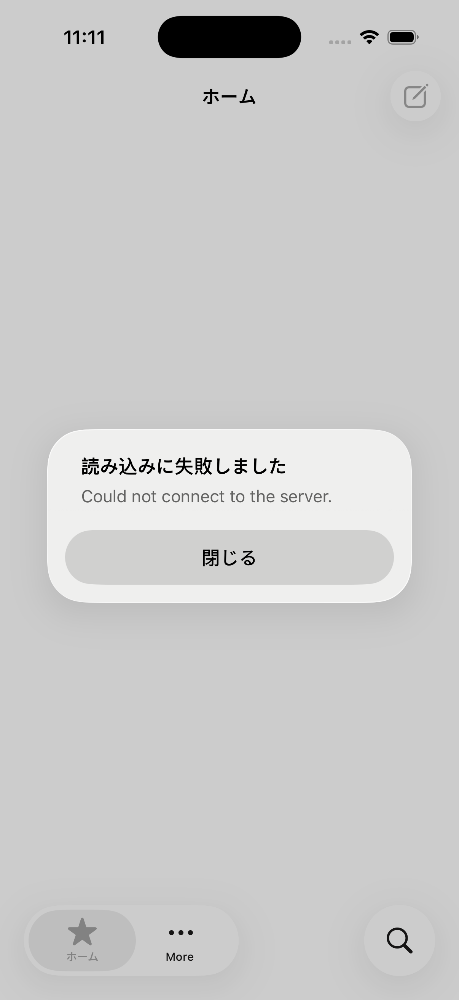

# X Relay Client

iOS 12以上で動作するUIKit製のXクライアントです。アプリはCGIキーのみをKeychainに保存し、XのCookieやCSRFトークンは保存しません。CGIは、サーバーの公開領域外に置かれた設定からXのログインセッションを読み取ります。

## リリース

最新版は [GitHub Releases](https://github.com/mizuki20070314/X_client_ios12/releases) から取得できます。

配布IPAはActionsで生成した署名なしIPAです。Impactorなどで再署名する場合も、`Payload/XRelayClient.app` がIPA直下にある標準構造で生成されています。App Store配布や実機へのインストールには、Apple Developerの証明書・プロビジョニングプロファイルで再署名してください。Simulatorでの動作確認済みアプリは、同じReleaseのスクリーンショットとともに公開されます。

## 起動

1. `sakura/README.md`の手順でPython CGIを設置し、XセッションとCGIキーを設定します。

   `sakura/setup_config.py`は`www`の外に置き、SSHで実行します。

2. Xcodeで `ios/XRelayClient.xcodeproj` を開き、iOS 12以上の端末またはシミュレータを選択します。
3. アプリの「設定」で公開サイトURL、CGIキー、必要ならプロフィール名を指定し、「接続テスト」を実行します。公開サーバーには`https://`を使用してください。

## 機能

- ホームタイムライン（アバター、認証バッジ、投稿時刻、画像、反応数）
- キーワード検索（話題／最新）
- テキスト投稿と返信
- ポストを開く／システム共有シートで共有
- X風の5タブナビゲーションとシステムのライト／ダーク表示
- 通知とDMの画面枠（CGI側APIが未対応のため、利用不可であることを表示）
- 複数プロフィールの `x-profile-name` 切り替え
- CGIキー認証（キーはiOS Keychainに保存）
- Relayへの接続テスト
- iOS Simulatorでの起動確認とホーム画面スクリーンショット

queryIdやfeature flagはアプリに固定せず、公開領域の`/requests.ndjson`から取得します。X Web App側で内部APIが変更された場合は、CGIとカタログを更新してください。
